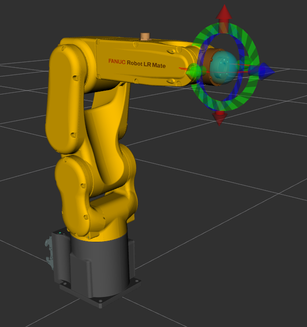
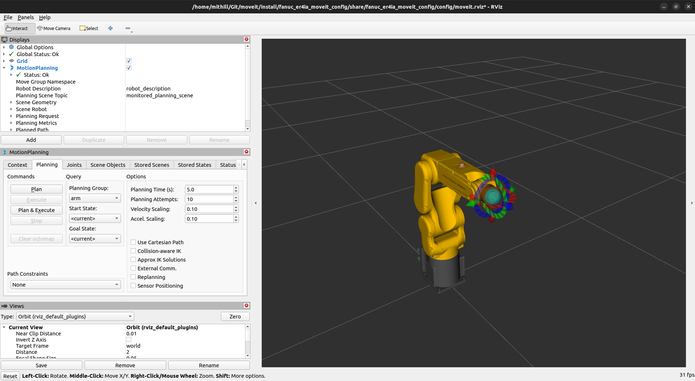

# `fanuc_er4ia_moveit_config`

[](https://github.com/MithillPrabhu/fanuc_er4ia_moveit_config/actions/workflows/ci.yml)
[](https://github.com/MithillPrabhu/fanuc_er4ia_moveit_config/actions/workflows/integration.yml)


[](LICENSE)

MoveIt 2 configuration package for the FANUC ER-4iA industrial robot on ROS 2 Humble.

<p align="center">
  
</p>

This repository packages the SRDF, controller settings, kinematics, RViz profile, and launch files needed to bring up the ER-4iA with MoveIt 2. It is intended for simulation, mock-hardware development, and integration with the FANUC ROS 2 driver stack.

## Features

- MoveIt 2 planning configuration for the FANUC ER-4iA
- Mock-hardware demo launch for local planning and RViz workflows
- Hardware-oriented launch entry point for integration with `fanuc_hardware_interface`
- KDL kinematics configuration
- Simple controller manager setup for trajectory execution
- Ready-to-use RViz configuration

## Robot Specifications

The package targets the FANUC ER-4iA 6-axis industrial robot.

- Robot family: LR Mate / ER series
- Degrees of freedom: 6
- Planning group: `arm`
- Base link: `base_link`
- Tool link: `fanuc_flange`

## Repository Structure

```text
fanuc_er4ia_moveit_config/
├── config/                  # MoveIt, ros2_control, SRDF, RViz, and kinematics settings
├── launch/                  # Demo, MoveIt, RViz, controller, and setup assistant launch files
├── .github/                 # CI, issue templates, and pull request template
├── docs/images/             # RViz screenshots used in this README
├── CMakeLists.txt
├── package.xml
├── README.md
├── CONTRIBUTING.md
├── CHANGELOG.md
├── CODE_OF_CONDUCT.md
└── LICENSE
```

## Requirements

- Ubuntu 22.04
- ROS 2 Humble
- MoveIt 2 for ROS 2 Humble
- `fanuc_lrmate_description`
- `fanuc_hardware_interface` for the hardware-oriented launch flow

Recommended upstream dependencies:

- `https://github.com/FANUC-CORPORATION/fanuc_description`
- `https://github.com/FANUC-CORPORATION/fanuc_driver`

## Installation

Create or reuse a ROS 2 Humble workspace and place this package in `src/` alongside the required FANUC packages:

```bash
mkdir -p ~/fanuc_ws/src
cd ~/fanuc_ws/src
git clone https://github.com/MithillPrabhu/fanuc_er4ia_moveit_config.git
git clone https://github.com/FANUC-CORPORATION/fanuc_description.git
git clone --branch humble https://github.com/FANUC-CORPORATION/fanuc_driver.git
```

Install binary dependencies:

```bash
cd ~/fanuc_ws
source /opt/ros/humble/setup.bash
rosdep install --from-paths src --ignore-src -r -y
```

## Build Instructions

```bash
cd ~/fanuc_ws
source /opt/ros/humble/setup.bash
colcon build --symlink-install --packages-select fanuc_er4ia_moveit_config
source install/setup.bash
```

## Usage

### Demo launch

Starts a self-contained mock-hardware MoveIt demo:

```bash
ros2 launch fanuc_er4ia_moveit_config demo.launch.py
```

### FANUC driver launch (mock, ROBOGUIDE, or real controller)

Starts MoveIt 2 on top of the official FANUC ROS 2 driver (`fanuc_hardware_interface`,
`ScaledJointTrajectoryController`). With `use_mock:=true` it runs without a controller:

```bash
ros2 launch fanuc_er4ia_moveit_config fanuc_er4ia.launch.py use_mock:=true
```

To target a physical or ROBOGUIDE controller:

```bash
ros2 launch fanuc_er4ia_moveit_config fanuc_er4ia.launch.py use_mock:=false robot_ip:=192.168.1.48
```

For ROBOGUIDE, `robot_ip` is the IP address of the Windows PC running ROBOGUIDE. The virtual
controller needs the J519 + R912 (or S636) software options. See
**[docs/roboguide_setup.md](docs/roboguide_setup.md)** for the full Windows, ROBOGUIDE and
network setup over Wi-Fi, plus troubleshooting.

### Additional launch examples

```bash
ros2 launch fanuc_er4ia_moveit_config move_group.launch.py
ros2 launch fanuc_er4ia_moveit_config moveit_rviz.launch.py
ros2 launch fanuc_er4ia_moveit_config setup_assistant.launch.py
```

### Tools

| Command | What it does |
| --- | --- |
| `ros2 run fanuc_er4ia_moveit_config fanuc_connection_check.py <ip>` | Read-only check that RMI (TCP 16001) and Stream Motion (UDP 60015) answer |
| `ros2 run fanuc_er4ia_moveit_config er4ia_motion_check.py` | Plans and executes 4 joint goals through MoveIt, then prints PASS or FAIL |
| `ros2 run fanuc_er4ia_moveit_config fanuc_controller_emulator.py` | Minimal RMI + Stream Motion stand-in for testing without ROBOGUIDE. Not FANUC software. |
| `test/integration_test.sh mock\|emulator` | End-to-end test that CI runs |

## RViz Screenshots

MoveIt 2 MotionPlanning panel with the `arm` planning group loaded:



## Future Work

- Richer documentation for RViz planning workflows
- Add example end-effector integration notes

## License

This project is released under the MIT License. See [LICENSE](LICENSE).

## Author

**Mithill Prabhu**, Robotics & Automation Engineer
[Portfolio](https://mithillprabhu.github.io) · [LinkedIn](https://www.linkedin.com/in/mithill-prabhu/) · psmithill27@gmail.com
